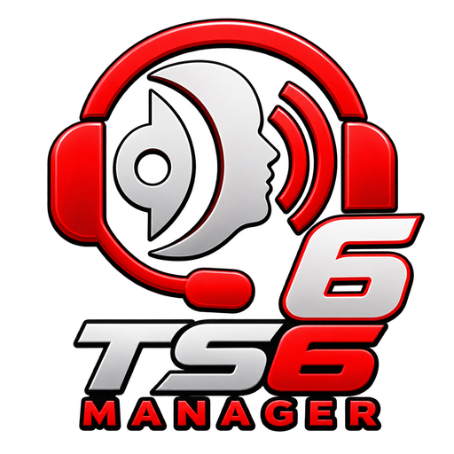
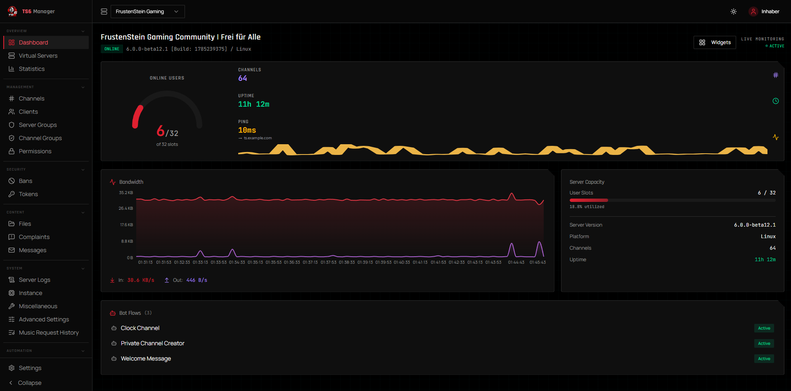
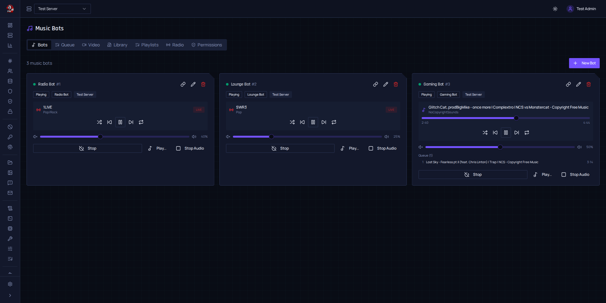
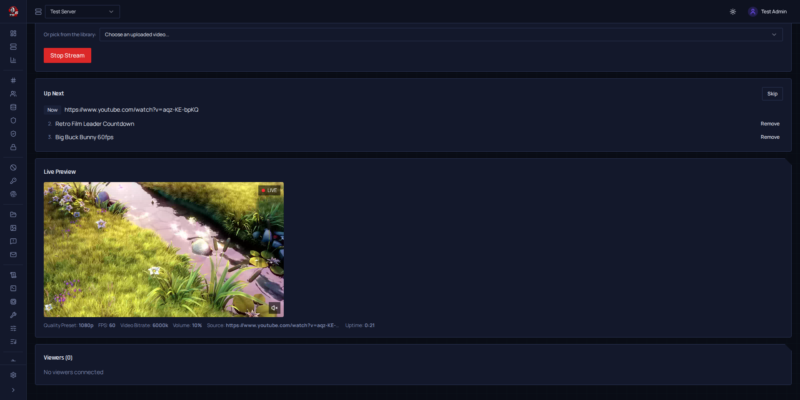
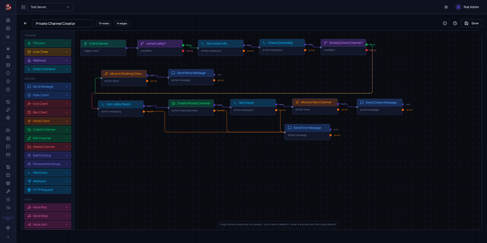
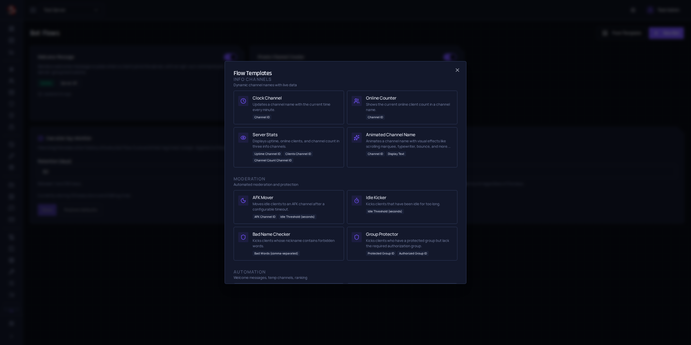
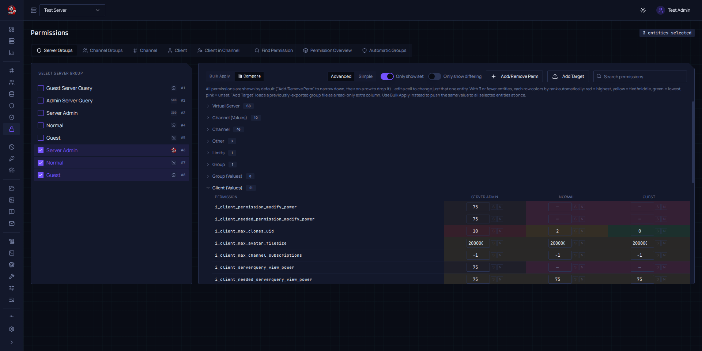

# TS6 Manager

A web interface for running TeamSpeak 6 servers: channels, clients, permissions, music bots, video streaming, automated workflows and embeddable status widgets, all in the browser.


It talks to TeamSpeak over the **WebQuery HTTP API**, the ServerQuery replacement in TeamSpeak 6. Telnet is not used.

> An AI-assisted fork of [clusterzx/ts6-manager](https://github.com/clusterzx/ts6-manager). See [Why This Fork Exists](#why-this-fork-exists).

## Screenshots

<details>
<summary><b>Dashboard, music bots, video streaming, bot flows and permissions</b> (click to expand)</summary>

### Dashboard
Live users, channels, uptime, ping and bandwidth of a virtual server, with tiles each user can arrange for their own account.



### Music Bots
Several bots per server, each with its own queue and volume, playing radio, YouTube or your own library.



### Video Streaming
Streams YouTube, Twitch, a direct URL or a library video into a channel over WebRTC.



### Bot Flows
A visual editor for automation: triggers, conditions and actions on a canvas.



Ready-made templates, imported with one click:



### Permissions
All five permission layers, with a side-by-side comparison that highlights the differences.



</details>

## Why This Fork Exists

Upstream had a video/audio streaming stutter that was never resolved and security findings nobody had triaged. This fork fixed the stutter at its root, hardened the security and has since added many features and fixes of its own. [CHANGELOG.md](CHANGELOG.md) lists every change, newest first.

## Requirements

**Where the manager runs:** Docker with the Compose plugin. ffmpeg, yt-dlp and everything else are part of the images.

**Memory:** at least 1 GB free for the manager. It uses about 250–350 MB itself, plus about 60 MB for each music bot while it plays (a song or a radio station). A TeamSpeak server on the same machine needs its own share on top.

**On the TeamSpeak server** (it can be a different machine):

- **WebQuery over HTTP is switched on.** It is off by default. `query_protocols` has to include `http`, set in `tsserver.yaml`, as a command-line flag or, for the official Docker image, with `TSSERVER_QUERY_HTTP_ENABLED=1`. On a rented server your host may have to do this.
- **A WebQuery API key.** The server prints a `serveradmin` key on its first start; otherwise create one with `apikeyadd`. Without a key, only the music bots work, and pages that need WebQuery are hidden.
- **The query port is reachable** (`query_http_port`, default `10080`) and the manager's address is on the server's query allowlist. Don't open this port to everyone. See [Getting Started](https://github.com/DomeNinchen/ts6forkmanager/wiki/Getting-Started).

**Only for some features:**

- **SSH ServerQuery** for bot flows that react to server events, live events in the Query console, and the Files and Icons pages. Everything else works over WebQuery alone.
- **UDP `50000-50100` open on the host** for video streaming. This traffic cannot go through an HTTP reverse proxy.

## Quick Start (Docker)

Starting from a fresh server? The wiki's [Install on Debian 13](https://github.com/DomeNinchen/ts6forkmanager/wiki/Install-on-Debian-13) walks through every step from the first login, Docker included.

1. Clone the repository. The images are built from source, so the compose file alone is not enough.

   ```bash
   git clone https://github.com/DomeNinchen/ts6forkmanager.git
   cd ts6forkmanager
   ```

2. Create a `.env` file with two random secrets. `JWT_SECRET` is required. `ENCRYPTION_KEY` encrypts stored TeamSpeak credentials; without it, `JWT_SECRET` is used for that too.

   ```bash
   echo "JWT_SECRET=$(openssl rand -base64 32)" >> .env
   echo "ENCRYPTION_KEY=$(openssl rand -base64 32)" >> .env
   ```

3. Create the shared Docker network, once per host. The compose file expects it to exist.

   ```bash
   docker network create ts6-network
   ```

4. Build and start the stack. The first build takes a few minutes.

   ```bash
   docker compose up -d --build
   ```

5. Open `http://localhost:3000/setup` and create your admin account.
6. Add your TeamSpeak server under **Settings → Connections**: host, WebQuery port and API key (the key can stay empty, see above).

**Good to know before you go live:**

- **Behind a reverse proxy, set `TRUST_PROXY`** to the number of proxies in front of the backend: `1` (default) for the frontend container alone, `2` with a host nginx or Coolify in front. **Settings → Network** shows the right value. A wrong value makes rate limits, the Connection Journal, the Change Log and IP bans see the wrong address. See [Deployment](https://github.com/DomeNinchen/ts6forkmanager/wiki/Deployment) and, if you ever ban yourself, [Troubleshooting](https://github.com/DomeNinchen/ts6forkmanager/wiki/Troubleshooting#an-ip-ban-locked-me-out-or-does-not-catch-the-visitor).
- **The containers run without root.** The frontend's nginx listens on port `8080` inside its container. The `volume-init` service fixes the volume ownership on every start and then exits, so `Exited (0)` for it is normal. Bind mounts need a one-time `chown -R 1000:1000`. See [Running unprivileged](https://github.com/DomeNinchen/ts6forkmanager/wiki/Deployment#running-unprivileged).

[Configuration](https://github.com/DomeNinchen/ts6forkmanager/wiki/Configuration) lists every environment variable.

## Features

**Server management**

- **Dashboard and statistics**: live stats, tiles each user arranges for themselves, up to a month of history, and an online count that can leave out chosen server groups and the music bots. → [Wiki](https://github.com/DomeNinchen/ts6forkmanager/wiki/Dashboard)
- **Channels and clients**: a drag-and-drop channel tree, bulk actions on online clients, and a searchable, exportable database of every client the server has seen. → [Channels](https://github.com/DomeNinchen/ts6forkmanager/wiki/Channels), [Clients](https://github.com/DomeNinchen/ts6forkmanager/wiki/Clients), [Client Database](https://github.com/DomeNinchen/ts6forkmanager/wiki/Client-Database)
- **Files and icons**: browse, upload and download channel files, and manage the icon pool. → [Files](https://github.com/DomeNinchen/ts6forkmanager/wiki/Files), [Icons](https://github.com/DomeNinchen/ts6forkmanager/wiki/Icons)
- **Permissions and groups**: all five layers, offline clients included, with bulk apply, compare and a per-client overview; server and channel groups with export/import. → [Permissions](https://github.com/DomeNinchen/ts6forkmanager/wiki/Permissions), [Groups](https://github.com/DomeNinchen/ts6forkmanager/wiki/Server-and-Channel-Groups)
- **Moderation**: bans, complaints, offline messages, privilege keys and temporary passwords. → [Moderation](https://github.com/DomeNinchen/ts6forkmanager/wiki/Moderation), [Tokens and Passwords](https://github.com/DomeNinchen/ts6forkmanager/wiki/Tokens-and-Passwords)
- **Virtual servers and the instance**: start, stop and create servers, edit settings, read logs, take snapshots. → [Virtual Servers and Instance](https://github.com/DomeNinchen/ts6forkmanager/wiki/Virtual-Servers-and-Instance), [Server Logs](https://github.com/DomeNinchen/ts6forkmanager/wiki/Server-Logs), [Server Maintenance](https://github.com/DomeNinchen/ts6forkmanager/wiki/Server-Maintenance)
- **Query console**: any ServerQuery command with completion, help and a safety check for dangerous commands. → [Wiki](https://github.com/DomeNinchen/ts6forkmanager/wiki/Query-Console)
- **Connection journal**: who signed in to the web interface or joined TeamSpeak, from where, with one-click IP bans. → [Wiki](https://github.com/DomeNinchen/ts6forkmanager/wiki/Connection-Journal)
- **Backups**: back up the manager's database now or on a schedule, with retention, a test that checks a backup without replacing anything, and ZIP download. → [Wiki](https://github.com/DomeNinchen/ts6forkmanager/wiki/Backups)
- **Change log**: every change made through the interface, with user, target, values sent (secrets masked), result and address, and before/after for channels, groups, permissions, server settings, bans and privilege keys. → [Wiki](https://github.com/DomeNinchen/ts6forkmanager/wiki/Change-Log)

**Automation and media**

- **Music bots**: several bots per server playing radio, YouTube, Spotify links and your own library, controlled in the browser or with chat commands such as `!play`. → [Wiki](https://github.com/DomeNinchen/ts6forkmanager/wiki/Music-Bots)
- **Video streaming**: YouTube, Twitch, direct URLs or library videos into a channel over WebRTC, with a queue and a browser preview. → [Wiki](https://github.com/DomeNinchen/ts6forkmanager/wiki/Music-Bots#video-streaming)
- **Bot flows**: a visual automation editor with triggers from server events, schedules, webhooks and chat commands, plus ready-made templates. → [Wiki](https://github.com/DomeNinchen/ts6forkmanager/wiki/Bot-Flows)
- **Server widgets**: status banners for websites and forums, as a live page, SVG or PNG, with their own online-count filter. → [Wiki](https://github.com/DomeNinchen/ts6forkmanager/wiki/Widgets)

**Access and appearance**

- **Security**: four roles with per-server access checked by the backend, two-factor sign-in, Single Sign-On via OpenID Connect, and encrypted stored credentials. → [Wiki](https://github.com/DomeNinchen/ts6forkmanager/wiki/Users-and-Roles)
- **Privacy**: no third-party requests, no HTTP cookies, and only what is needed stored in the browser. This describes the software and is not legal advice. → [Wiki](https://github.com/DomeNinchen/ts6forkmanager/wiki/Privacy-and-Hosting)
- **Appearance**: two layouts (Cockpit and Lounge), eleven themes and ten accent colours, as an installation default that each user can override. → [Wiki](https://github.com/DomeNinchen/ts6forkmanager/wiki/Themes-and-Appearance)
- **Language**: English, German and French, with more translated by the community on [Crowdin](https://crowdin.com/project/ts6forkmanager).
- **Administration**: users and sessions, yt-dlp cookies, debug switches, scheduled restarts and update status. → [Wiki](https://github.com/DomeNinchen/ts6forkmanager/wiki/Administration)

## Documentation

The [Wiki](https://github.com/DomeNinchen/ts6forkmanager/wiki) has the full documentation. Good places to start:

- [Getting Started](https://github.com/DomeNinchen/ts6forkmanager/wiki/Getting-Started): connect your server, and what WebQuery and SSH are each for
- [Tips and Pitfalls](https://github.com/DomeNinchen/ts6forkmanager/wiki/Tips-and-Pitfalls): behaviour that looks like a bug but isn't
- [Troubleshooting](https://github.com/DomeNinchen/ts6forkmanager/wiki/Troubleshooting): what to check when something doesn't happen
- [Deployment](https://github.com/DomeNinchen/ts6forkmanager/wiki/Deployment): reverse proxies, Coolify, updates and backups
- [Development](https://github.com/DomeNinchen/ts6forkmanager/wiki/Development): architecture, and running it from source

## Known Issues (Upstream TS6 Server Bug)

- **TS3 clients don't see the music bot's avatar** ([teamspeak/teamspeak6-server#122](https://github.com/teamspeak/teamspeak6-server/issues/122)). TS6 clients see it; TS3 clients get stuck on "Loading Image". The TS6 server causes this, so only a TeamSpeak server update can fix it.

## License

GPLv3
